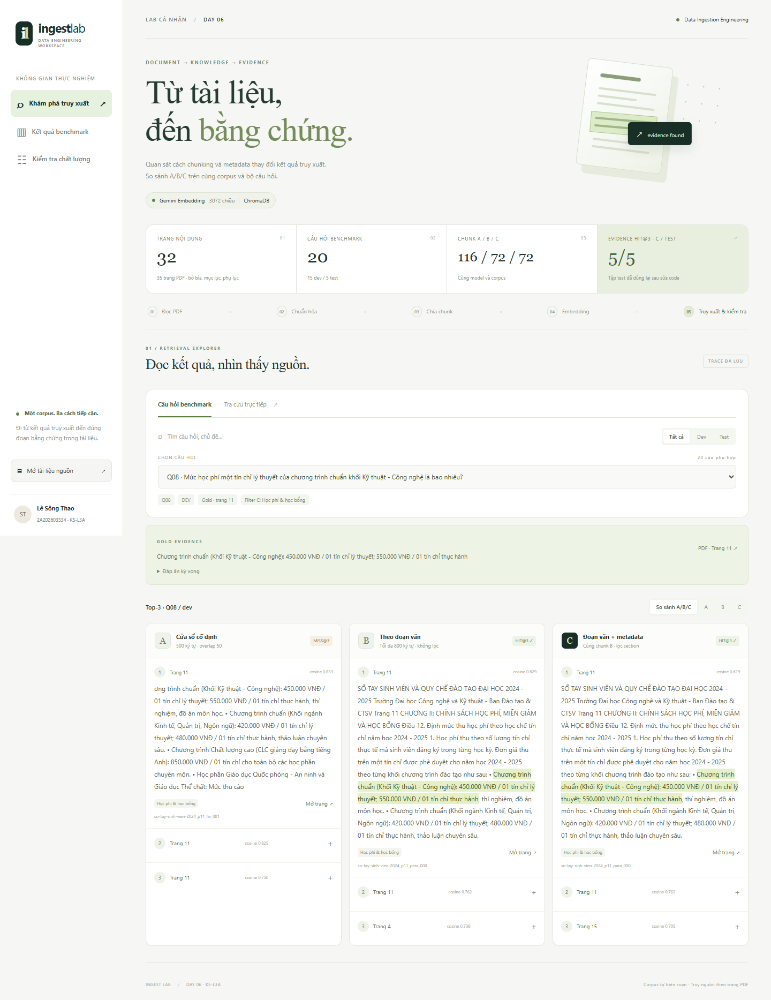

# Ingest Lab — Day 06

**Lê Sông Thao · 2A202603534 · K5-L3A**

Pipeline đọc PDF, chia chunk, tạo embedding và so sánh ba cấu hình retrieval trên cùng dữ liệu. Giao diện demo giúp xem top-3, đối chiếu evidence và mở lại đúng trang nguồn.



## Chạy demo

Môi trường đã kiểm tra: **Python 3.12.10**. Chạy từ thư mục root:

```bash
python -m pip install -r requirements.txt
python -m demo
```

Mở **http://127.0.0.1:8765**. Đổi cổng bằng `python -m demo --port 8766`.

Demo mặc định dùng kết quả đã lưu; **không cần API key**, không gọi Gemini và không tạo số liệu mới. Có thể:

- Chọn 20 câu benchmark, lọc dev/test hoặc tìm theo từ khóa.
- So sánh top-3 của A/B/C và xem evidence được đánh dấu trong chunk.
- Mở PDF đúng trang, xem chỉ số retrieval và nhãn coherence/grounding.
- Xuất bảng nhãn JSON để đối chiếu với báo cáo.

## Pipeline và truy vấn mới

Copy `.env.example` thành `.env` và điền `GEMINI_API_KEY` trên máy của bạn. Cài key ở phía Python; giao diện không nhận hay lưu key.

```bash
# Dựng lại index và chạy benchmark — có dùng Gemini API/quota
python -m src.run

# Cách chạy tương đương
python -m starter.src.run

# Bật tra cứu câu hỏi mới sau khi đã dựng database
python -m demo --live
```

Hai lệnh pipeline là lựa chọn thay thế nhau, không cần chạy cả hai. `--live` cần `.env` và `results/chroma_db`; mặc định không bật. Với truy vấn mới, người dùng có thể chỉ định section cho C. Kết quả này chưa có gold, nên không tự tính Hit@1/Hit@3 và không ghi đè benchmark.

## Cấu hình và kết quả đã lưu

| Cấu hình | Cách chuẩn bị/truy xuất | Chunk | Dev Hit@3 | Test Hit@3 |
|---|---|---:|---:|---:|
| A | 500 ký tự, overlap 50, không lọc | 116 | 12/15 | 3/5 |
| B | Theo đoạn/câu, tối đa 800 ký tự, không lọc | 72 | 15/15 | 5/5 |
| C | Cùng chunk/vector B, thêm filter section khi có yêu cầu | 72 | 15/15 | 5/5 |

Model: `gemini-embedding-001`, 3072 chiều. Vector store: ChromaDB persistent, cosine/HNSW. Corpus có 35 trang vật lý, tính 32 trang nội dung sau khi bỏ bìa, mục lục và phụ lục. Đây là tài liệu tự biên soạn phục vụ lab; các số liệu trong đó không được coi là chính sách của một trường cụ thể.

Benchmark giữ 15 dev/5 test, trong đó ba câu có filter. Test đã được dùng lại sau khi sửa code/gold; kết quả hiện tại là kiểm tra hồi quy, **không phải holdout độc lập**. Nhãn audit được ghi kèm lý do và [xác nhận của tác giả](artifacts/audit_confirmation.json) ngày 14/11/2026. Xác nhận được ràng buộc với hash corpus và bảng nhãn; sửa dữ liệu hoặc nhãn sẽ làm mất hiệu lực xác nhận cũ.

## Kiểm tra bài

```bash
python scripts/verify_submission.py
python scripts/test_evaluation_strict.py
python scripts/test_obsolete_chunks.py
python scripts/test_pipeline_safety.py
python scripts/test_demo.py
```

Các lệnh trên chạy offline, không cần key. Kiểm thử dùng dữ liệu giả lập nhỏ ở phạm vi kiểm tra nhánh lỗi; các vector này không được dùng trong kết quả thí nghiệm.

Kiểm tra UI tùy chọn: `python scripts/test_demo_ui.py`, cần Playwright và một bản Edge/Chromium đã cài. Script thử trên desktop/mobile rồi lưu ảnh trong `assets/`. Đây không phải dependency để chạy demo.

Để tổng hợp lại audit từ trace đã lưu: `python scripts/generate_audit_data.py`. Lệnh này không tạo một lần chấm mới. GitHub Actions có cấu hình chạy các kiểm tra offline sau push/PR.

## Cấu trúc bài nộp

```text
demo/                             Giao diện và HTTP server local
src/                              Pipeline chính
starter/src/                      Bản sao tương thích của src/
data/manifest.json                Nguồn gốc, số trang/ký tự và hash corpus
benchmark/benchmark_questions.json Câu hỏi, split, đáp án và evidence
artifacts/                        Experiment log và xác nhận bảng chấm
results/                          Trace, summary, audit và log trang bỏ qua
report/individual/                Báo cáo cá nhân và mẫu báo cáo
scripts/                          Kiểm thử, đóng gói và công cụ kiểm tra
```

Sau khi sửa code/data, cập nhật bản sao trong `starter/` rồi chạy `verify_submission.py`. Database Chroma là dữ liệu runtime, không commit; người chấm có thể dựng lại bằng pipeline. Trace đầy đủ vẫn được giữ trong repo để xem demo offline.

## Đóng gói

```bash
python scripts/package_submission.py
```

Gói nằm ở `exports/Day06_2A202603534_LeSongThao.zip`, chứa source, demo, PDF, benchmark, artifacts và báo cáo. `SNAPSHOT.json` ghi hash từng file và commit nền; nếu workspace chưa commit, thông tin đó được ghi rõ. Gói loại `.env`, `.git`, môi trường ảo và database runtime, không thay cho việc push repo theo hướng dẫn lớp.

Demo chỉ bind `127.0.0.1` và phục vụ các route cố định. Xem [phạm vi bảo mật và kiểm thử](SECURITY.md).

[Báo cáo cá nhân](report/individual/2A202603534_LeSongThao.md) · [Rubric](RUBRIC.md) · [Yêu cầu nộp](SUBMISSION.md) · [Quy tắc sử dụng công cụ](RULES.md) · [Repo đề bài](https://github.com/VinUni-AI20k/K5-L3-Day06-DataIngestionEngineering)
